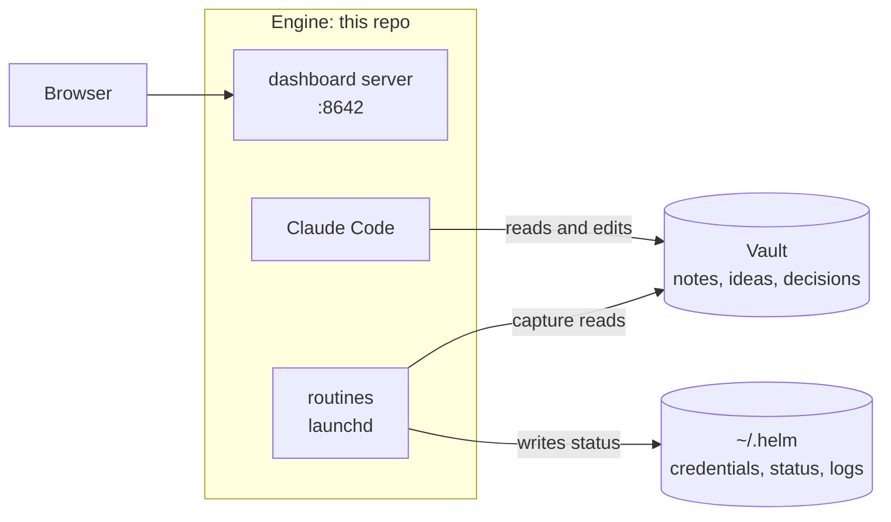

# HELM

[](https://github.com/danielgentile22/helm/actions/workflows/ci.yml)

A personal operating system that runs on one always-on Mac. It reads a private
Obsidian vault and runs the owner's routines against it. This repo is the engine. It
knows nothing about the person it serves until it reads their vault, so everything
personal stays out of it.

The interface is being rebuilt. For now the dashboard server answers with a placeholder
page.

## What runs

- **The dashboard server** (`dashboard/`). A Python standard library server on
  loopback with a passkey door for the tailnet, a health route, and a placeholder
  Svelte 5 page. The next interface is built on it.
- **Routines** (`runner/`). launchd jobs generated from `models.json`: capture
  (deterministic producers that read ideas, schedules and git state every 30
  minutes), a daily integrity check that proves every router pointer in the vault
  still resolves, and a backup that snapshots the vault to a local drive when it is
  mounted.

## Three homes



| Home | Holds | Rule |
|---|---|---|
| this repo | code, docs, a demo vault | public, and history is forever |
| the vault | notes, ideas, decisions | private git repo with no remote |
| `~/.helm` | credentials, status, logs | private, mostly disposable |

A commit-time guard enforces the first rule. `pre-commit`, `commit-msg` and
`pre-push` hooks check every added line, path and commit message against a deny list
kept outside the repo, a path allowlist, and secret, email and phone patterns. A
missing deny list fails closed. Its tests run in CI.

## Try it against the demo vault

```bash
git clone https://github.com/danielgentile22/helm && cd helm
export HELM_VAULT_ROOT=$PWD/demo-vault HELM_STATE=$(mktemp -d)
python3 runner/producers/capture.py
(cd dashboard && npm ci) && python3 dashboard/serve.py
```

The dashboard opens on `127.0.0.1:8642`.

## Security model

The Mac runs Claude Code with broad permissions, so every surface is built to be
reachable by exactly one person. Servers bind to loopback only. The dashboard splits its
routes into loopback-only, tailnet and open by endpoint, and its tailnet door is a
WebAuthn passkey. The records are in
`docs/adr/`, starting with 0003 (bind to loopback), 0016 (reach split by endpoint) and
0025 (the tailnet door is a passkey).

## Decisions

`docs/adr/` holds 34 architecture decision records. 0001 to 0009 are from HELM 1, the
earlier version, whose code and heads-up display live at the `helm1-final` tag. 0010
onward cover the engine as it runs today.

## Tests

CI runs the guard tests, the engine's Python suites and the dashboard's checks on every
push to `main`. `CLAUDE.md` lists the commands.

## License

MIT
